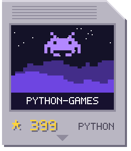
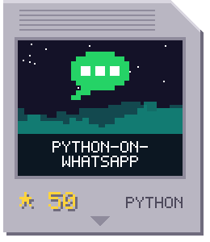
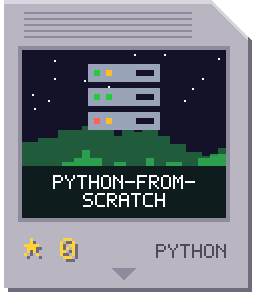
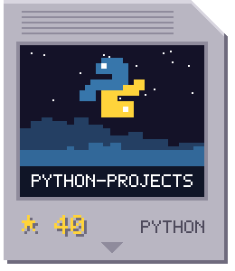
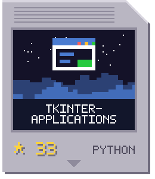
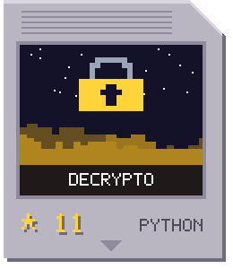

<picture>
  <source media="(prefers-color-scheme: dark)" srcset="assets/run-dark.svg">
  <source media="(prefers-color-scheme: light)" srcset="assets/run-light.svg">
  
</picture>

  <b>Player 1: Prajjwal Pathak, aka pyGuru</b> · Varanasi, India

I make games in Python, build backend systems from scratch on
[YouTube](https://www.youtube.com/@itspyguru), and run [Cybiqon](https://cybiqon.in),
a small software studio that makes websites, apps and AI automation.

Each column in the level above is one week of my last year on GitHub. Taller means more
commits; the coins sit on my five biggest weeks. The level is redrawn every night, so
the runner always plays the current year.

### 🕹️ Pick a cartridge

  
  
  

  
  
  

### 💾 Now playing

<!-- NOW:START -->
- ▸ **[python-from-scratch](https://github.com/itspyguru/python-from-scratch)** · Backend systems built from scratch in Python, one folder per itsPyguru video: Redis-style cache, load balancer · saved 23 days ago
- ▸ **[python-load-balancer-health-checks](https://github.com/itspyguru/python-load-balancer-health-checks)** · A Python load balancer from scratch: round-robin across 3 FastAPI backends, a background health-check loop, and a real kill-a-server test · saved 29 days ago
- ▸ **[Agentic-AI-projects](https://github.com/itspyguru/Agentic-AI-projects)** · An end to end agenetic ai assitant built with langchain & streamlit · saved 165 days ago
<!-- NOW:END -->

### 🎮 Controls

  <a href="https://www.youtube.com/@itspyguru">▶ YouTube</a> &nbsp;·&nbsp;
  <a href="https://www.instagram.com/itspyguru/">◆ Instagram</a> &nbsp;·&nbsp;
  <a href="https://www.linkedin.com/in/itspyguru/">■ LinkedIn</a> &nbsp;·&nbsp;
  <a href="https://t.me/itspyguru">● Telegram</a> (fastest way to reach me)

  
🔒 Secret level

   
  

  - Melomaniac, otaku, and a fan of Ruskin Bond's stories.
  - I read theoretical physics for fun and think about what else is out there in the cosmos.
  - I like photography, cryptography and designing things.
  - El Psy Kongroo.

The header and cartridges are plain SVGs drawn by <a href="scripts/build.py">scripts/build.py</a> (Python, no dependencies) and refreshed daily by a GitHub Action. No third-party stats services.
